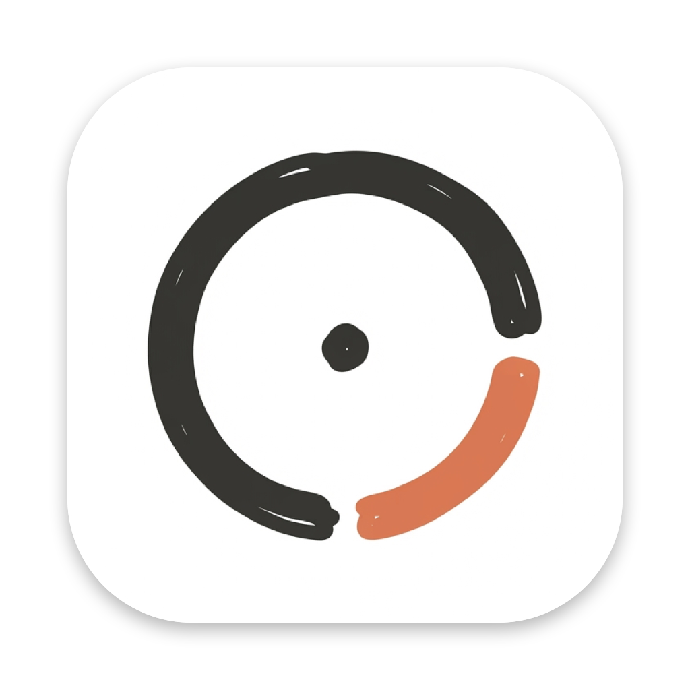

<div align="center">



# ClaudeBarLimit

**Your Claude usage, always one glance away.**

Stop typing `/usage` to find out how close you are to the limit.<br>
ClaudeBarLimit keeps your Claude Code session usage in the macOS menu bar, together with the time it resets.

<a href="https://github.com/tfiechowski/claude-bar-limit/releases/latest"></a>

<sub>Free and open source · macOS 13+ · Apple Silicon & Intel · ~200 KB download</sub>

<br>


<sub><code>C: 53%</code>: 53% of your current 5-hour session is used.</sub>

</div>

---

## Why

Claude Code's usage limits are invisible until you hit them. You only notice when you're in the middle of a refactor and get stopped. ClaudeBarLimit shows the number all the time, so you can plan around it:

- 🟢 **See where you stand at a glance.** Session usage sits in your menu bar next to the clock.
- ⏱️ **Know when the limit resets.** You get a countdown plus the local time, so you know whether to wait or switch tasks.
- 📅 **Keep an eye on the weekly cap too.** Weekly usage appears whenever Claude Code reports it.
- 🔐 **No setup.** It uses the Claude Code login you already have: no API key, no extra sign-in, no plugins.
- 🪶 **Small and private.** It's a native Swift app with no tracking and no server, and it isn't in your Dock.

Click the number to see the details:

```text
ClaudeBarLimit — updated just now
Current session (5h): 53% used
   47% remaining
   Resets in 2h 14m (16:30)
Weekly (7d): 21% used
   79% remaining
   Resets in 3d 4h (Nov 25 09:00)
──────────────────────────────
Refresh now                   ⌘R
  Show remaining in menu bar
✓ Open at login
Refresh every               1 min ›
──────────────────────────────
Open Claude billing
Open Claude
```

## Install

You need [Claude Code](https://docs.anthropic.com/en/docs/claude-code) installed and signed in with a Claude subscription.

### Option 1: Download (recommended)

1. Download **`ClaudeBarLimit-<version>-macOS.zip`** from the [latest release](https://github.com/tfiechowski/claude-bar-limit/releases/latest).
2. Unzip it and drag **ClaudeBarLimit.app** into **Applications**.
3. Open it. Your usage appears in the menu bar within a few seconds.

> [!NOTE]
> **First launch only:** the app is free and open source, but it isn't notarized by Apple, because notarization requires a paid developer account. If macOS blocks it, go to **System Settings → Privacy & Security**, scroll down, and click **Open Anyway** ([Apple's guide](https://support.apple.com/en-us/102445)). You only need to do this once. Never turn off Gatekeeper globally.

### Option 2: Homebrew

```sh
brew install --cask tfiechowski/tap/claude-bar-limit
```

Update with `brew upgrade --cask tfiechowski/tap/claude-bar-limit`. The first-launch note above applies here too.

<details>
<summary><b>Build from source</b></summary>

You need Xcode Command Line Tools, but only to build the app.

```sh
git clone https://github.com/tfiechowski/claude-bar-limit.git
cd claude-bar-limit
./scripts/build.sh
open dist/ClaudeBarLimit.app
```

</details>

## FAQ

<details>
<summary><b>Does checking usage spend my quota?</b></summary>

No. ClaudeBarLimit runs Claude Code's built-in `/usage` command. Claude Code handles that command locally and doesn't send a prompt to a model. This was verified against Claude Code 2.1.x; see [docs/COMPLIANCE.md](docs/COMPLIANCE.md).
</details>

<details>
<summary><b>Is <code>C: 19%</code> used or remaining?</b></summary>

It shows how much you've used by default. To see what's left instead, turn on <i>Show remaining in menu bar</i>.
</details>

<details>
<summary><b>What do <code>C: ?%</code> and <code>⚠︎</code> mean?</b></summary>

`?` means the app couldn't read your usage. This usually happens when Claude Code isn't installed or you aren't signed in, and the menu tells you which. `⚠︎` means the last refresh failed or the data is old, so the number may be out of date.
</details>

<details>
<summary><b>Usage can't be read. What now?</b></summary>

Run `claude -p "/usage"` in Terminal. If that prints a `Current session: …` line but the app doesn't show your usage, [open an issue](https://github.com/tfiechowski/claude-bar-limit/issues) and include the output. Remove anything private first.

If Claude Code is installed somewhere non-standard, point the app at it:

```sh
defaults write dev.tfi.claudebarlimit customCLIPath /path/to/claude
```
</details>

<details>
<summary><b>Does it need an API key or run a background server?</b></summary>

No to both.
</details>

<details>
<summary><b>How do I uninstall?</b></summary>

Quit the app from its menu and delete it from Applications. If you installed it with Homebrew, run `brew uninstall --cask tfiechowski/tap/claude-bar-limit` instead.
</details>

## Privacy

ClaudeBarLimit has no accounts, telemetry, analytics, or backend, and it makes no network requests of its own. On each refresh it runs your locally installed Claude Code (`claude -p --no-session-persistence /usage`), and Claude Code may contact Anthropic. ClaudeBarLimit never reads your credentials, keychain, or cookies.

## License

[MIT](LICENSE). This is an unofficial open-source utility. It isn't affiliated with or endorsed by Anthropic.
