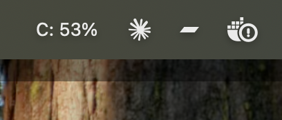

# ClaudeBarLimit

**Claude usage, always one glance away.**

A tiny, free macOS menu-bar app that shows your Claude Code usage and reset times. It reuses the Claude Code login you already have — no separate authentication, API keys, SwiftBar, or setup.

<p align="center"></p>

## Install in one command

```sh
brew install --cask tfiechowski/tap/claude-bar-limit
```

Launch ClaudeBarLimit from Applications. Look for `C: 19%` in your menu bar — that means 19% of your current 5-hour session limit has been used.

**Requirements:** macOS 13+ (Apple Silicon and Intel), Claude Code installed and signed in with a Claude subscription. Homebrew is only needed for the Homebrew install. This build is ad-hoc signed and **not Apple-notarized**, so macOS may ask for one-time approval on first launch: open **System Settings → Privacy & Security** and choose **Open Anyway** ([Apple's guide](https://support.apple.com/en-us/102445)).

## What you get

- Current 5-hour session usage at a glance
- Reset time (as a countdown and local time) and weekly usage, when Claude Code reports them
- Refresh now, used/remaining toggle, refresh interval (1/5/10 min), billing shortcut
- No extra login, no tracking

## Other ways to install

- **ZIP:** download the latest `ClaudeBarLimit-*-macOS.zip` from [Releases](https://github.com/tfiechowski/claude-bar-limit/releases), unzip, drag `ClaudeBarLimit.app` to Applications, and approve it on first launch as above.
- **From source** (needs Xcode Command Line Tools, build-time only):
  ```sh
  git clone https://github.com/tfiechowski/claude-bar-limit.git
  cd claude-bar-limit
  ./scripts/build.sh
  open dist/ClaudeBarLimit.app
  ```

## FAQ

- **Does this need an API key?** No.
- **Does it need Claude Code?** Yes — installed and signed in with a subscription. Without it the menu bar shows `C: ?%` and the menu explains what's missing.
- **Is `C: 19%` used or remaining?** Used by default. Switch with *Show remaining in menu bar*.
- **What does `⚠︎` next to the number mean?** The last refresh failed or the data is old, so the number may be out of date.
- **Does it run a background server?** No.
- **Does checking usage spend my quota?** No. It runs Claude Code's built-in `/usage` command, which is handled locally and sends no prompt to a model (verified against Claude Code 2.1.x; see [docs/COMPLIANCE.md](docs/COMPLIANCE.md)).
- **Why does macOS warn me?** The app isn't notarized (that requires a paid Apple Developer account). Use *Open Anyway* as described above; never disable Gatekeeper globally.
- **Update?** `brew upgrade --cask tfiechowski/tap/claude-bar-limit`
- **Uninstall?** `brew uninstall --cask tfiechowski/tap/claude-bar-limit`
- **Usage can't be read?** Run `claude -p "/usage"` in Terminal. If that prints a `Current session: …` line but the app doesn't, [open an issue](https://github.com/tfiechowski/claude-bar-limit/issues) with the output (redact anything private). Claude Code is in a non-standard location? `defaults write dev.tfi.claudebarlimit customCLIPath /path/to/claude`

## Privacy

ClaudeBarLimit has no accounts, telemetry, analytics, or backend, and makes no network requests itself. Every refresh runs your locally installed Claude Code (`claude -p --no-session-persistence /usage`), which may itself contact Anthropic. ClaudeBarLimit never reads your credentials, keychain, or cookies.

## License

MIT. Unofficial open-source utility; not affiliated with or endorsed by Anthropic.
